  

  <a href="https://arunrajagopal-ot.github.io/">Website</a> ·
  <a href="https://www.linkedin.com/in/arajagopal/">LinkedIn</a> ·
  Chartered Engineer · London, United Kingdom

---

## Engineering industrial cybersecurity

I work where **industrial engineering, cybersecurity and operational risk** meet. My background spans more than 25 years across automation, control systems, engineering leadership and cybersecurity.

I focus on turning cyber requirements into engineering decisions that support **safety, availability and operational continuity**, from architecture and risk assessment through product security and assurance.

  

## Systems, standards & domains

`IEC 62443` `NCSC CAF` `NIS / NIS2` `Cyber Resilience Act` `ISO/SAE 21434`

`PLC` `SCADA` `DCS` `SIS` `Industrial Networks` `Critical Infrastructure`

Oil & gas · Energy & renewables · Rail & transportation · Pharmaceuticals & life sciences · Manufacturing · Aviation

<strong>Credentials & professional standing</strong>

 

- **Chartered Engineer (CEng)** | Engineering Council UK
- **ISA/IEC 62443 Cybersecurity Expert**
- **ISASecure ACSSA for Evaluators Specialist (IC49)**
- **Certified Functional Safety Expert** | TÜV SÜD
- **Certified Automotive Cybersecurity Practitioner (CACSP)** | TÜV SÜD, ISO/SAE 21434
- **Senior Member, International Society of Automation** and former President, ISA UK Section
- Executive MBA | Henley Business School
- BEng (Hons), Electronic & Communication Engineering | Robert Gordon University, Aberdeen

## Publications

  

Read the article: [The EU Cyber Resilience Act: What Does It Mean for UK Suppliers?](https://www.automation.com/article/the-eu-cyber-resilience-act-what-does-it-mean-uk-suppliers) · Automation.com, *Navigating CRA* column

## Speaking opportunities

  

Upcoming: Panelist, "Who Owns the Decision?", Industrial Cyber Days (link to follow) · ICS Switzerland Webinar (details to follow)

---

  <strong>Industrial systems. Practical cybersecurity. Engineering-led assurance.</strong>  
  <a href="https://arunrajagopal-ot.github.io/">Professional website</a> ·
  <a href="https://www.linkedin.com/in/arajagopal/">LinkedIn</a>

